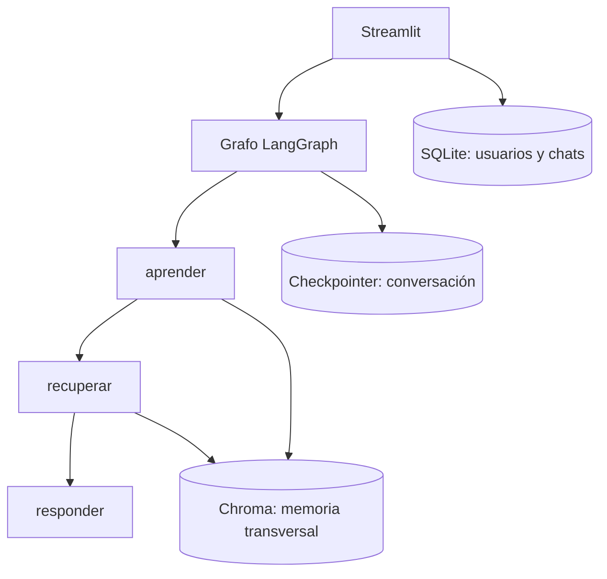

# 🧠 Chat multiusuario con memoria avanzada


Aplicación de chat multiusuario construida con **Streamlit**, **LangGraph** y
**Chroma**. Cada usuario tiene sus propios chats y, además, una **memoria
transversal** que sobrevive a las conversaciones: lo que cuenta en un chat lo
recuerda en el siguiente.

Es una demo local con fines educativos. No es un producto y no tiene
autenticación real.

## ✨ Qué demuestra

- **Dos memorias separadas**:
  - *Memoria de contexto*: la conversación de cada chat, guardada en el
    checkpointer de LangGraph (`thread_id` = id del chat).
  - *Memoria transversal*: los hechos del usuario (nombre, trabajo,
    preferencias), guardados en Chroma y compartidos por todos sus chats.
- **Aprendizaje antes de responder**: el grafo extrae y guarda el hecho del
  mensaje actual antes de generar la respuesta, para que un cambio recién
  contado se use en el mismo turno.
- **Sustituciones conscientes**:
  - un cambio de empleo desactiva el empleo anterior **y** sus datos
    dependientes (zonas, clientes, departamento);
  - las preferencias se suman salvo que el usuario diga explícitamente que ha
    cambiado de opinión;
  - el nombre se guarda con una red determinista («me llamo X», «mi nombre es
    X») aunque el extractor lo confunda con un saludo.
- **Recuperación garantizada**: los hechos personales y profesionales activos
  se inyectan siempre; el resto se añade por similitud.
- **Memoria visible y editable** desde la interfaz, con histórico de lo
  sustituido.

## 🗺️ Cómo funciona



El orden importa: `aprender` va antes de `recuperar` y `responder`. Así el hecho
que el usuario acaba de contar ya está en la memoria que se inyecta en ese
mismo turno. La contrapartida es que el primer token tarda un poco más; la
interfaz lo tapa con un spinner («Actualizando memoria…»).

## 📁 Estructura

```
multiuser_chat/
├── app.py                 # Interfaz Streamlit (4 pantallas)
├── config.py              # Rutas, modelo, categorías y parámetros
├── db.py                  # SQLite: usuarios y chats
├── users.py               # Alta, baja y consulta de usuarios
├── chats.py               # Alta, baja, título automático y actividad
├── memory_manager.py      # Chroma: altas, sustituciones y consultas
├── graph.py               # Grafo LangGraph y extracción de memoria
├── .streamlit/config.toml # Tema de la interfaz
├── ruff.toml              # Configuración de lint
├── requirements.txt
├── .env.example
└── .gitignore
```

## 🚀 Puesta en marcha

Requiere **Python 3.12** y una clave de OpenAI.

```bash
git clone <url-del-repositorio>
cd multiuser_chat

python -m venv .venv
source .venv/bin/activate        # Windows: .venv\Scripts\activate

pip install -r requirements.txt

cp .env.example .env
# Edita .env y escribe tu OPENAI_API_KEY

streamlit run app.py
```

Se abre en `http://localhost:8501`.

### Variables de entorno

| Variable | Obligatoria | Descripción |
|---|---|---|
| `OPENAI_API_KEY` | Sí | Clave de OpenAI para el modelo y los embeddings. |

`config.py` busca el `.env` en la carpeta del proyecto y en las superiores.
El `.env` está en `.gitignore`: no se sube nunca.

## 🖥️ Uso

1. **Usuarios**: crea un usuario. No hay login; el selector sirve para separar
   memorias, no para autenticar.
2. **Mis chats**: crea una conversación. El título se genera solo con el primer
   mensaje.
3. **Chat**: conversa. Los datos estables que cuentes se guardan en tu memoria.
4. **Memoria**: consulta, edita o borra los recuerdos. Puedes mostrar también
   los sustituidos para ver el histórico.

## 🧩 La memoria en detalle

### Memoria de contexto

- Un hilo del checkpointer por chat (`thread_id` = id del chat).
- Al modelo se le envían los últimos `MAX_HISTORY_MESSAGES` mensajes.
- El estado conserva la conversación completa: al reabrir un chat aparecen
  todos los mensajes.

### Memoria transversal

- Una colección de Chroma por usuario (`memoria_<slug>`), con distancia coseno.
- Cada recuerdo guarda categoría, texto, chat de origen, fechas y un flag
  `activo`.
- Sustituir no borra: el recuerdo anterior se marca como inactivo y se conserva
  el rastro.
- Categorías: `personal`, `profesional`, `preferencias` y
  `hechos_importantes`.

### Reglas del extractor

- **Hueco único** (empleo actual, ciudad, estado civil…): el hecho nuevo
  sustituye al anterior, aunque el usuario no diga «ya no».
- **Datos dependientes**: al cambiar de empleo se desactivan también las zonas
  o clientes que dependían de él.
- **Preferencias**: se suman. Solo se sustituyen con un cambio explícito («ya
  no», «ahora prefiero», «he dejado de»…).
- **Nombre**: red determinista para «me llamo X» y «mi nombre es X».
- Si el hecho ya está guardado, se ignora: no se reprocesa ni se usa para
  desactivar otro recuerdo por error.

### Recuperación

- Siempre se inyectan los recuerdos activos de `personal`, `profesional` y
  `hechos_importantes`.
- Además, hasta `MAX_MEMORY_RESULTS` recuerdos extra por similitud con el
  mensaje, sobre todo de `preferencias`.
- Así una pregunta como «¿a qué me dedico?» no puede quedarse con el trabajo
  antiguo solo porque se parezca más al texto.

## 🗃️ Datos y reinicio

Todo el estado está en `data/`:

| Ruta | Contenido |
|---|---|
| `data/chat.db` | Usuarios y chats (SQLite) |
| `data/checkpoints.sqlite` | Conversaciones completas (LangGraph) |
| `data/chroma/` | Memoria transversal (Chroma) |

Para empezar de cero, con la aplicación parada:

```bash
rm -f  data/chat.db
rm -f  data/checkpoints.sqlite
rm -f  data/checkpoints.sqlite-shm
rm -f  data/checkpoints.sqlite-wal
rm -rf data/chroma
```

`chat.db` contiene también los usuarios: se borran usuarios, chats,
conversaciones y memorias. La carpeta `data/` se recrea sola al arrancar.

## ⚙️ Configuración

Los parámetros están en `config.py`:

| Parámetro | Valor por defecto | Para qué |
|---|---|---|
| `DEFAULT_MODEL` | `gpt-4o-mini` | Modelo de respuesta y extracción |
| `DEFAULT_TEMPERATURE` | `0.3` | Creatividad de la respuesta |
| `MAX_HISTORY_MESSAGES` | `20` | Mensajes que se envían al modelo |
| `MAX_MEMORY_RESULTS` | `3` | Recuerdos extra por similitud |
| `CATEGORIAS_SIEMPRE` | personal, profesional, hechos importantes | Se inyectan siempre |
| `UMBRAL_DUPLICADO` | `0.25` | Distancia para considerar un duplicado |
| `EMBEDDING_MODEL` | `text-embedding-3-small` | Embeddings de Chroma |
| `EXTRAER_CADA_N_TURNOS` | `1` | Frecuencia de extracción |

Cambiar el modelo de embeddings o el umbral exige **reiniciar Streamlit**: hay
clientes y funciones cacheadas en `memory_manager.py`.

## ⚠️ Limitaciones

- No hay autenticación: cualquiera puede entrar como cualquier usuario.
- La detección de contradicciones es heurística: depende de que el extractor
  rellene bien `sustituye_a`. Si falla, pueden quedar dos hechos
  contradictorios activos y hay que corregirlos desde Memoria.
- En preferencias, un gusto nuevo se suma salvo cambio explícito.
- No hay búsqueda de texto en todas las conversaciones: no existe tabla de
  mensajes; la conversación es del grafo.
- Cada mensaje hace dos llamadas al modelo (extracción y respuesta), con su
  coste correspondiente.

## ✅ Calidad

```bash
pip install ruff
ruff check .
```

La configuración de lint está en `ruff.toml`. El proyecto no incluye una suite
de tests formal; las comprobaciones se han hecho con pruebas manuales y con
dobles de modelo sobre Chroma en memoria.
